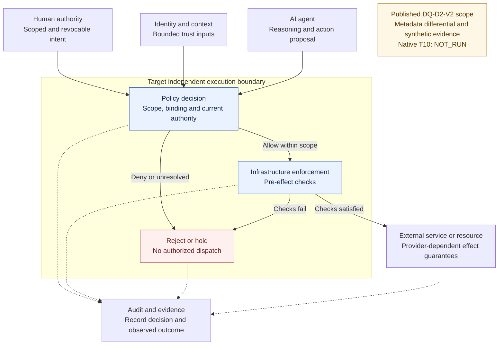

# Digital Qareen Research

**Independent authorization. Human sovereignty. Verifiable execution evidence.**

[Research release v0.1.0-research](https://github.com/abdalrahman-alakhras/digital-qareen-research/releases/tag/v0.1.0-research) | [Verify the evidence](VERIFICATION.md) | [Reproducibility](REPRODUCIBILITY.md) | [Research roadmap](ROADMAP.md) | [Cite this release](CITATION.cff)

> **Research status:** Scoped public evidence collection. Not the complete framework, a production security product, or an operational certification.

## The problem

AI agents may hold legitimate identities, valid credentials and powerful execution capabilities while proposing actions outside the authority granted by the human they represent. Permission to use a tool is not necessarily authorization for a particular action, recipient, data scope or moment of execution.

Digital Qareen investigates how proposed actions, independently constrained authorization, infrastructure enforcement and auditable evidence can remain distinct security boundaries, including when trusted assumptions fail. The DQ-D2-V2 release addresses a narrower metadata-integrity research question within that broader vision; it does not demonstrate that the proposed end-to-end architecture is operational.

## Conceptual architecture

The diagram describes the **target research architecture**, not a deployed system. The policy and enforcement components must be independently protected from the proposing agent under a defined threat model. A valid identity alone does not authorize an external effect.

The separate DQ-D2-V2 box identifies what has actually been published. It is not an implemented authorization gateway or evidence of a non-bypassable runtime. External acceptance, in-flight revocation and irreversible effects require provider-specific guarantees; unknown outcomes must be represented explicitly.

## Start here

| Reader goal | Reference |
| --- | --- |
| Inspect the fixed research release | [v0.1.0-research](https://github.com/abdalrahman-alakhras/digital-qareen-research/releases/tag/v0.1.0-research) |
| Check the original 12-file archive without running the candidate | [VERIFICATION.md](VERIFICATION.md) |
| Review reported tests and reproduction gaps | [REPRODUCIBILITY.md](REPRODUCIBILITY.md) |
| Examine the original nine diagnostic artifacts | [Artifact README](diagnostics/dq_d2_v2/README.md) |
| Understand future research and threat-model questions | [ROADMAP.md](ROADMAP.md) |
| Cite the fixed release | [CITATION.cff](CITATION.cff) |
| Review publication terms | [RIGHTS.md](RIGHTS.md) |

The tagged release remains fixed at commit `0867c28a807a96b8e65a2900903dc213cfb91e2a` and contains 12 files. Later documentation improvements on main are not part of that original archive. The [original release README](https://github.com/abdalrahman-alakhras/digital-qareen-research/blob/0867c28a807a96b8e65a2900903dc213cfb91e2a/README.md) and its provenance manifest remain preserved at the reference commit. Preparation-time status fields in the manifest are historical records, not current repository visibility indicators.

## DQ-D2-V2: Metadata Differential - scoped research evidence

A standalone research artifact collection exploring metadata integrity as one component of deterministic AI execution governance. This is not the full Digital Qareen framework, a deployment package, or a production security product.

The collection contains nine unchanged diagnostic artifacts under [`diagnostics/dq_d2_v2/`](diagnostics/dq_d2_v2/README.md): a review-only candidate, two synthetic harnesses, a native fixture plan and schema, an acceptance crosswalk, two original verification receipts, and a scoped README.

### Recorded evidence

| Verification | Recorded result | Environment |
|---|---|---|
| Synthetic acceptance V2 | 20/20 methods; 6 reported passing subtests | Linux, CPython 3.13.5 |
| Targeted V2 regressions | 3/3 methods; 19 reported passing subtests | Linux, CPython 3.13.5 |
| Native Windows T10 | NOT_RUN | Not executed |

The two suites exercised selected AST projections using synthetic observations. They did not run the complete candidate or establish end-to-end authorization, filesystem atomicity, platform equivalence, OS containment, memory isolation, or worker/provider certification. Subtests are not independent suite runs. See the [artifact README](diagnostics/dq_d2_v2/README.md) for the precise test scope.

### Provenance and integrity

[`PROVENANCE.json`](PROVENANCE.json) records raw SHA-256, Git blob SHA-1 and byte counts for each original artifact. Those pins match the nine-file payload and the owner-reported local commit `4711472f2653ca719ab6b15602faf87806a52c4a` (tree `0fd05a70af9e91649c5f0d39c9c253cc7dbe44b8`). That local commit is not included in this standalone repository, and its history is not transferred. This repository has separate commit identities. The provenance record is a reported linkage with byte-level crosswalk, not a signature or a publicly verifiable proof of the private commit's ancestry.

To inspect integrity, hash the raw downloaded files and compare to `PROVENANCE.json`. For example, in Windows PowerShell, `Get-FileHash -Algorithm SHA256 -LiteralPath 'diagnostics/dq_d2_v2/DQ_I1B2_D2_Metadata_Differential_V2.py'` checks the candidate. Do not normalize line endings when checking raw hashes.

### Reproducibility boundaries

The historical receipts retain their original PENDING_REVIEW statuses. The full controlled runner, complete original archives and external enforcement evidence are not part of this collection. The harnesses expose synthetic suite builders; this is not a standalone reproduction of the recorded execution envelope. The candidate CLI intentionally refuses execution. Do not invoke the live diagnostic callable against a live environment on the authority of these artifacts.

### Rights and review

See [RIGHTS.md](RIGHTS.md). This collection is not released under an open-source license. The material is offered for technical inspection subject to applicable law and platform terms. No operational execution authority is conferred.

AI Can Propose.  
Policy Must Authorize.  
Infrastructure Must Enforce.  
Evidence Must Prove.
